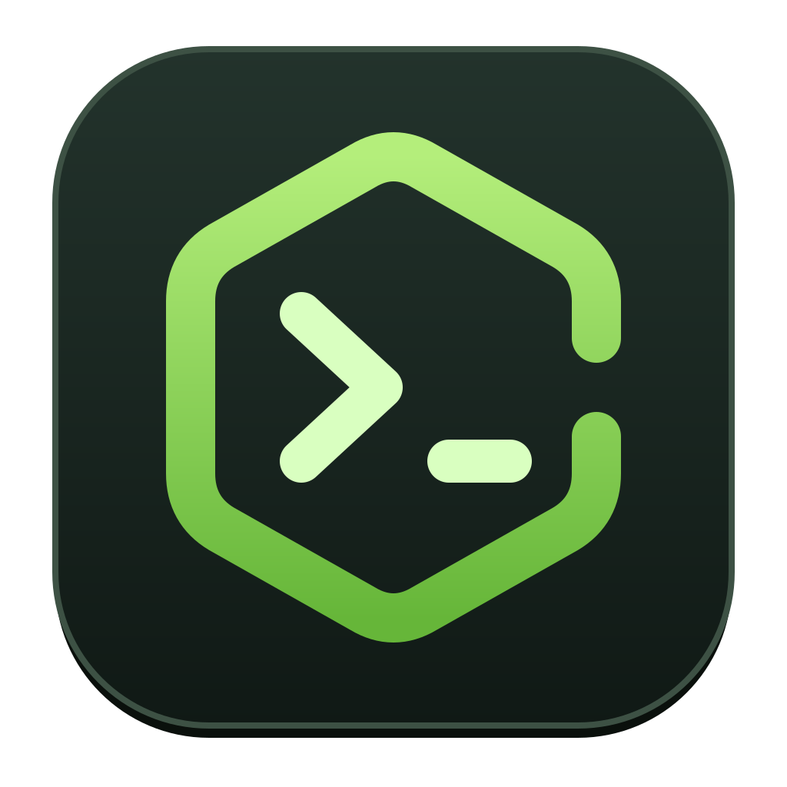

  

<h1 align="center">Total.js Totem</h1>

An AI coding environment written as a Total.js 5 application: open a project, talk to an agent that reads code, edits files and runs commands, and review what changed. You choose the model: a free cloud one, one running on your computer, or a paid one.

> **In design.** There is no code and nothing to download yet. The plan is in [`docs/`](docs/README.md).

- [Vision](docs/vision.md)
- [Architecture](docs/architecture.md)
- [Roadmap](docs/roadmap.md)
- [Open decisions](docs/decisions.md)
